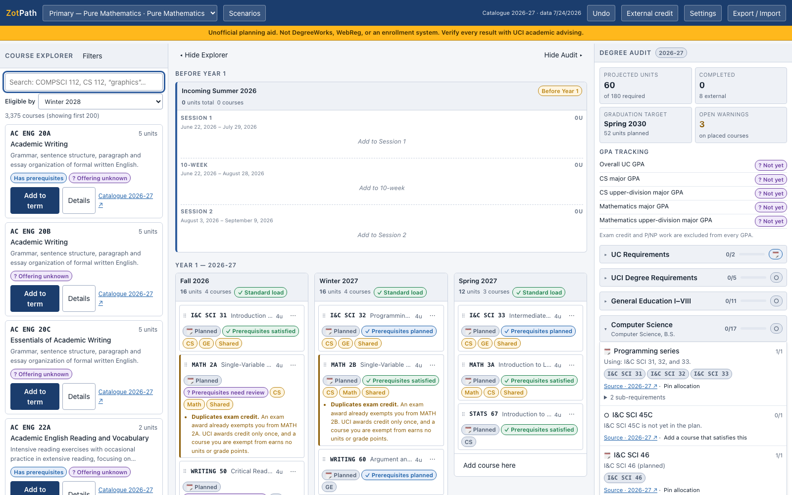

# ZotPath

A four-year course planner for **UCI Computer Science (B.S.)** students, built on the
**2026–27 UCI Catalogue**. You can plan CS on its own or add a Mathematics second major.

> **Unofficial.** ZotPath is a planning aid, not an official degree audit. It isn't DegreeWorks or
> WebReg. Always double-check your plan with a UCI academic adviser.



## What it does

- **Search every UCI course** and add courses to any quarter, from Summer 2026 through graduation.
- **Check prerequisites** and warn you when a course is in the wrong quarter or a quarter is
  overloaded.
- **Track your degree progress** live: CS major requirements, GE, and UC/UCI requirements.
- **Apply your AP credit** so you can see which courses it clears.
- **Compare scenarios**, for example CS only vs. CS + Math.
- **Transfer view** (optional): see how your plan lines up with transfer requirements at other
  universities.

Your plan is saved in your own browser. There's no account and nothing is uploaded.

## Setup

You need [Node.js](https://nodejs.org/) 20 or newer.

```bash
git clone https://github.com/RishiMadduluri/ucicourseplanner.git
cd ucicourseplanner
npm install
npm run dev
```

Then open <http://localhost:5173> in your browser.

## How to use it

1. **Setup screen.** Pick **Computer Science only** (the default) or add a Math second major. Then
   enter your AP scores and choose how many units you want per quarter. You can skip this and
   change it later with the **Settings** and **External credit** buttons.
2. **Add courses.** Search for a course in the left panel (for example `CS 161` or `ICS 33`) and
   add it to a quarter.
3. **Check the Degree Audit** on the right. It updates as you go and shows what's done, what's
   planned, and what's still missing.
4. **Save or share a plan.** Use **Export / Import** to save your plan as a file, or load one
   someone sent you.

## Getting updates

```bash
git pull
npm install
npm run dev
```

Pulling new code doesn't touch your saved plan.

## For contributors

- `npm test` runs the unit tests, and `npm run verify` runs every check (types, lint, tests, build).
- The app code is in `src/`. The degree rules are in `src/domain/requirements/programs/`.
- The original design notes and requirement research are in `planning/`.
